<h1 align="center">Varsity Maps</h1>

<p align="center">
  <b>Campus navigation, run by the campus.</b><br>
  A multi-university platform where every institution owns its map data, and students get accurate pedestrian-first routing, multi-mode directions and live turn-by-turn guidance.
</p>

<p align="center">
  <a href="https://varsitymaps.azurewebsites.net"></a>
</p>

<p align="center">
  
  
  
  
  
</p>

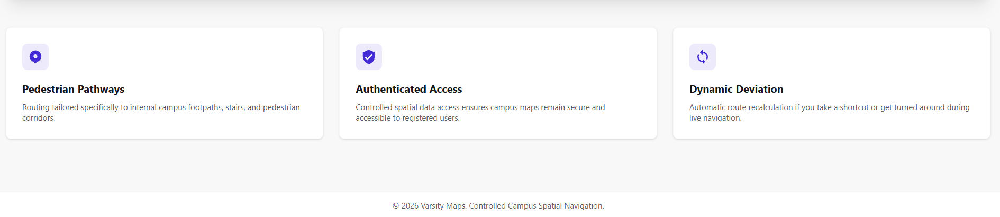

---

## Try it live

**[varsitymaps.azurewebsites.net](https://varsitymaps.azurewebsites.net)** is running right now.

1. Open the site and choose **Student Portal**.
2. Register with any email, pick a university and campus. (The institutional verification step is simulated in this build.)
3. Search for a building, hit **Get Directions**, and try **Walk, Cycle, Bus** and **Car**.
4. Choose **Preview with Mock Navigation** to watch live guidance, off-route detection and recalculation without leaving your desk.

Administrator roles are approval- and invitation-gated by design, so they are shown in the [walkthrough](#the-journey-from-visitor-to-navigator) below. If you would like a guided tour of the admin side, get in touch.

---

## Why Varsity Maps?

Campuses are not road networks. General-purpose map apps route you along public roads, miss the footpaths and shortcuts people actually use, and give the university no way to correct its own map or decide who can see it.

Varsity Maps turns that around. **The institution owns the map.** Each university models its own campus (buildings, entrances, parking, footpaths, closures), and the platform computes routes over that data. Google Maps only draws the satellite tiles; all routing, rules and data management are Varsity Maps' own.

---

## Highlights

### A campus editor that makes mapping approachable
- Draw **building footprints** point by point, with accessibility, guest-access and pass-through settings.
- Add **entrances** that must sit within 5 m of the building boundary, each with optional **interests** (for example *Classes* or *Lecturer offices*), so one building can have several purpose-specific doors.
- Draw **parking areas** and attach access nodes that connect them to the path network.
- Place chains of path nodes in a few clicks, or **quick-connect** two existing nodes. Paths are weighted by their real-world length automatically.
- Set per-path **travel modes** (walk, cycle, bus, car) and **closures**, including closed *until* a date.
- Smart guard rails: warnings when a building overlaps existing paths or a path crosses a building, bulk select by click or by node range, an unsaved-changes guard, and a **Show Google labels** switch to draw with or without the base map's labels.

### Routing that understands a campus
- **Dijkstra's algorithm** over the institution's own node-and-path graph, filtered by travel mode, with closed paths excluded.
- **Multi-mode directions:** Walk, Cycle, Bus and Car. When a vehicle can't start from your building, you choose where you parked and get a **park-then-walk** route, clearly labelled *Parking transfer*.
- **Entrance-aware destinations:** "What are you visiting?" targets the right door, or compare routes to every entrance.
- **Start from where you stand:** your GPS position is snapped onto the nearest path segment, so you can route from anywhere on campus, not only from a building.
- **Turn-by-turn instructions** generated from the route geometry, with a clear *Continue on foot after parking* hand-over.

### Live navigation that behaves
- Tracks your position and advances the current instruction as you progress.
- **Off-route detection tuned for real GPS:** a tolerance that adapts to reported accuracy, and several consecutive readings before alerting, so a single noisy fix never cries wolf.
- One tap to **recalculate** from your current location (and a polite *"Are you still driving, or have you started walking?"* for vehicle routes).
- A built-in **mock navigation** mode that simulates movement and deviation. It makes the feature easy to demo and test indoors.

### Multi-university by design
- Four roles with strictly separated powers: **System Admin, University Admin, Campus Admin, Standard User**.
- Every request is checked against the caller's tenant, not just their role, so changing an id in a URL never exposes another institution's data.
- **Guest access:** students can switch to another institution's campus; they only see the buildings and parking the host campus has marked as guest-accessible. The identity token is re-issued on every switch so the server always knows the active campus.

### Careful onboarding and governance
- Institutions register and wait for **System Admin approval**, with recorded rejection reasons.
- University admins invite campus admins with **PIN-protected invitations**: pending, accepted, expired, locked, declined or revoked, with extend, resend and revoke actions.
- PINs are stored only as HMAC hashes, and **three wrong attempts lock the invitation**.
- Administrators can be suspended or unassigned, and accounts are **soft-deleted** so an email can be safely re-used.

### Designed with real users
A five-person usability study covering every role produced a **mean SUS score of 81.0**, comfortably above the 68 benchmark. The findings, including the places where live navigation needed work, fed straight back into the app.

---

## The journey: from visitor to navigator

The system comes to life in the order a real deployment would: an institution applies, gets approved, builds its campus, and then students use it.

### 1. Visitor
| | |
|---|---|
| 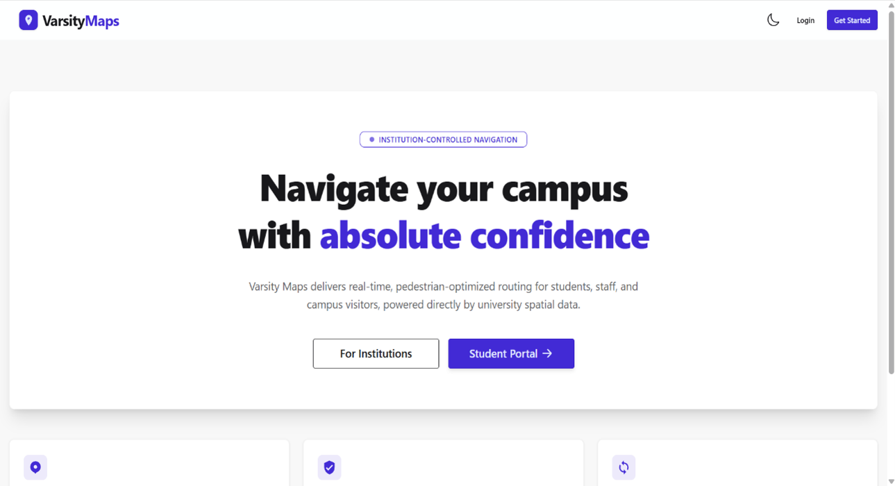 | 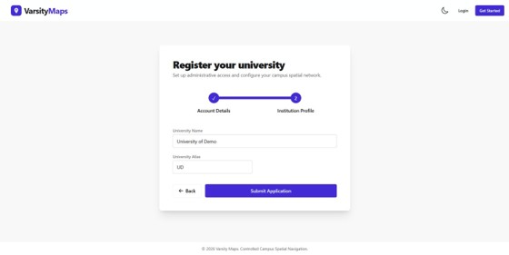 |
| *Landing page with the two entry points* | *Two-step institution registration* |

### 2. System Admin approves the institution
| | |
|---|---|
| 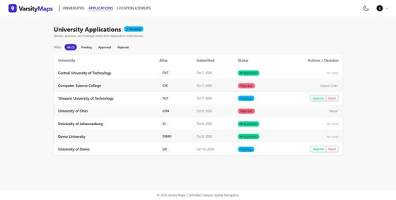 | 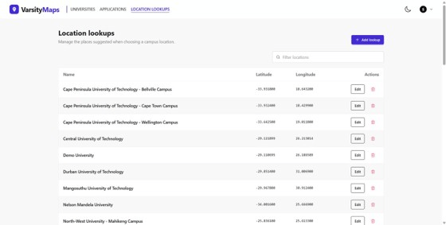 |
| *Application queue with approve / reject* | *Curated location lookups with a map picker* |

### 3. University Admin sets up campuses and invites administrators
| | |
|---|---|
| 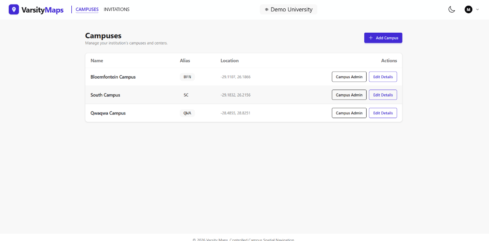 | 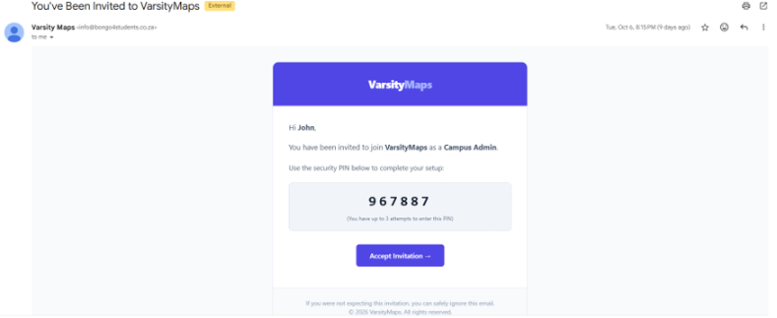 |
| *Campuses and their administrators* | *PIN-protected invitation email* |
| 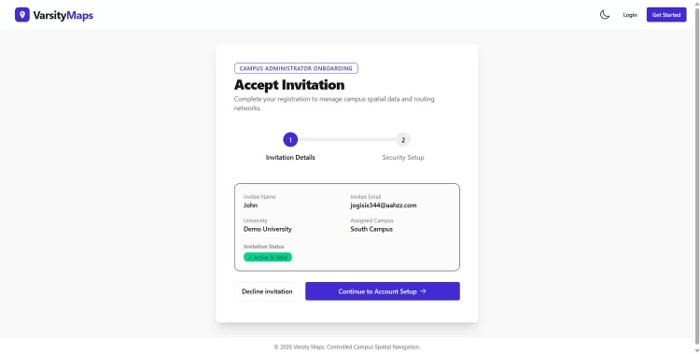 | |
| *Accepting an invitation* | |

### 4. Campus Admin builds the campus
| | |
|---|---|
| 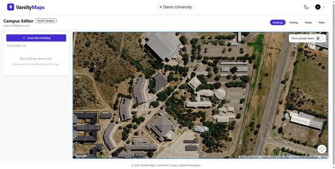 | 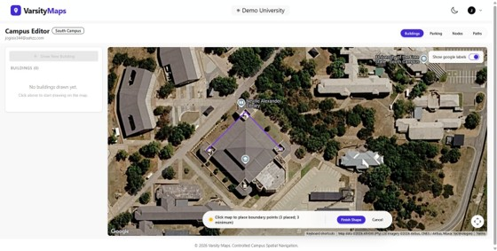 |
| *Buildings and entrances* | *Drawing a building footprint* |
| 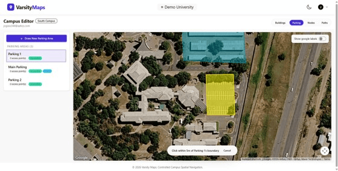 | 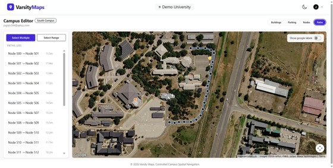 |
| *Parking areas and access nodes* | *Path properties: modes and closures* |

### 5. Standard User searches, routes and navigates
| | |
|---|---|
| 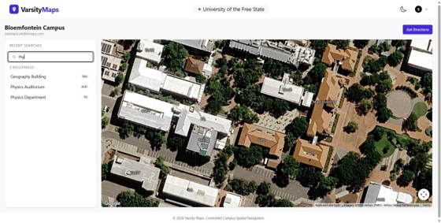 | 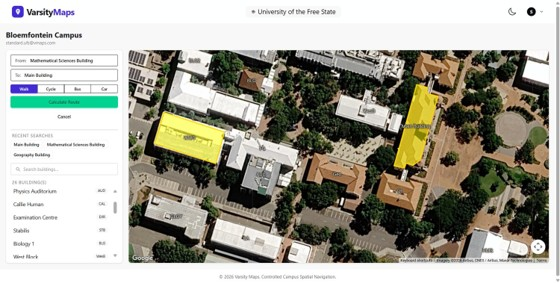 |
| *Building search and campus map* | *Route options across travel modes* |
| 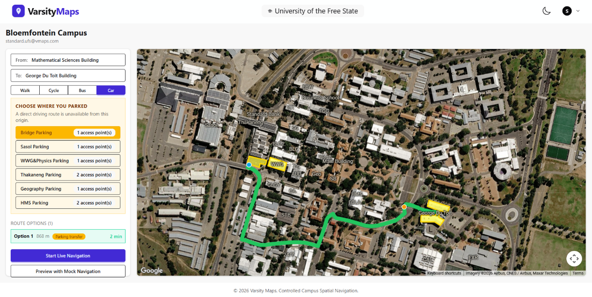 | 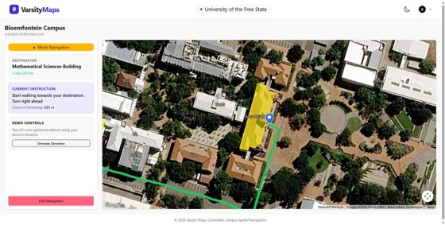 |
| *Park-then-walk route* | *Live navigation with guidance* |
| 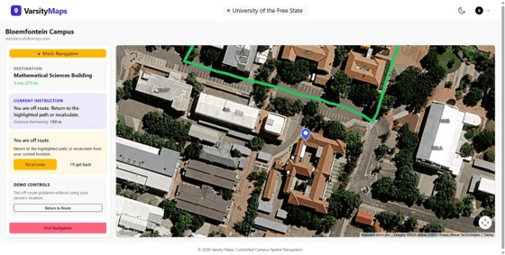 | 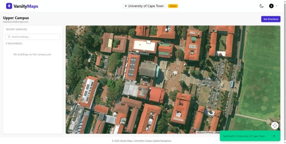 |
| *Off-route detection and recalculation* | *Guest access to another institution* |

---

## How it works

```
┌────────────────────────┐   HTTPS / JSON    ┌───────────────────────────┐    EF Core    ┌─────────────────────┐
│  Angular 20 client     │ ────────────────▶ │  ASP.NET Core Web API     │ ────────────▶ │  SQL Server         │
│  Google Maps (tiles)   │ ◀──────────────── │  Identity + JWT           │ ◀──────────── │  geometry columns   │
│  Role-based UI         │                   │  Services (RouteService)  │               │  NetTopologySuite   │
│  Live location         │                   │  Repositories + Unit of   │               └─────────────────────┘
└────────────────────────┘                   │  Work                     │
                                             └───────────────────────────┘
```

**The campus is a graph.** Buildings expose entrance nodes; paths are edges with a weight (metres), allowed travel modes and optional closures. Each edge is stored once and expanded to both directions when the in-memory adjacency list is built, so there is no reverse row to drift out of sync.

**Routing pipeline**
1. Load the campus's edges and keep only those open to the requested mode.
2. If the origin is a GPS point, **snap** it to the nearest edge and split that edge with a temporary virtual node in a *copy* of the edge list. The real graph is never mutated.
3. Run Dijkstra from each origin entrance to each destination entrance, using a priority queue with lazy deletion.
4. For Car and Bus, compute the vehicle leg to a parking area's access nodes, then a walking leg to the destination, and stitch them with a transition step.
5. Convert the geometry into guidance: bearing between consecutive points, the signed turn angle normalised into a half-open range, and a merge of consecutive straight segments.

**Spatial data** is stored as SQL Server `geometry` (SRID 4326): polygons for buildings and parking, points for nodes, line strings for routes. NetTopologySuite handles containment, distance and intersection checks on the server.

---

## Under the hood

A few decisions I'm proud of, and why:

- **Tenant checks on every id, not just role checks.** Role policies answer "may this kind of user do this?"; tenant checks answer "may this user touch this row?". Cross-tenant lookups return `404`, which doesn't confirm the row exists.
- **Claims are a snapshot, so switching context re-issues the token.** Switching campus or institution returns a fresh token, keeping server-side resolution of the active campus honest.
- **Soft delete with a global query filter, and one deliberate escape hatch** to revive a dormant account, validating the row's original state *before* mutating it.
- **Derived state beats stored flags.** "Expired", "locked" and "closed" are computed from timestamps and counters at read time, so there is no cron job and nothing can be left open by mistake.
- **A mockable location seam.** Live and simulated location emit the same update shape, which makes deviation handling demonstrable and testable.
- **Client-side pre-validation that mirrors the server.** Mistakes are caught at the click, while NetTopologySuite remains the authority.
- **One conversion layer for coordinates.** GeoJSON uses `[lng, lat]`; Google Maps uses `{ lat, lng }`. Conversions live in one place so a swapped pair can never silently put a point in the wrong hemisphere.
- **An imperative SDK behind a declarative component.** The map component takes polygons, markers and polylines as inputs and reconciles them against the Maps SDK, so the rest of the app never touches `google.maps` directly.
- **Modern Angular:** standalone components, signals, zoneless change detection, functional guards, reactive forms with custom `ControlValueAccessor` inputs, and cross-field validation.

---

## Tech stack

| Layer | Technology |
|-------|-----------|
| Frontend | Angular 20, TypeScript, signals, Tailwind CSS, daisyUI |
| Map rendering | Google Maps JavaScript API (visualisation only) |
| Backend | ASP.NET Core Web API (.NET 10), C# |
| Data access | Entity Framework Core 10 (Code First), NetTopologySuite |
| Database | Microsoft SQL Server with spatial `geometry` types |
| Auth | ASP.NET Core Identity, JWT access tokens, refresh-token cookie |
| Email | MailKit (SMTP) |
| Hosting | Microsoft Azure |


---

## Run it locally

### Prerequisites
- [.NET 10 SDK](https://dotnet.microsoft.com/download)
- [Node.js](https://nodejs.org/) (LTS) and the Angular CLI (`npm i -g @angular/cli`)
- Microsoft SQL Server (LocalDB, Express or full)
- A [Google Maps JavaScript API key](https://developers.google.com/maps/documentation/javascript/get-api-key)
- An SMTP account for invitation emails (a throwaway account or Mailtrap works for testing)

### 1. Clone
```bash
git clone https://github.com/<your-username>/<repo-name>.git
cd <repo-name>
```

### 2. Configure the API
Keep secrets out of source control with [user secrets](https://learn.microsoft.com/aspnet/core/security/app-secrets):

```bash
cd API
dotnet user-secrets init

dotnet user-secrets set "ConnectionStrings:DefaultConnection" "Server=(localdb)\\MSSQLLocalDB;Database=VarsityMaps;Trusted_Connection=True;TrustServerCertificate=True"

# Must be at least 64 bytes
dotnet user-secrets set "TokenKey" "<a-long-random-string-of-64-or-more-characters>"

dotnet user-secrets set "MailSettings:Host" "smtp.example.com"
dotnet user-secrets set "MailSettings:Port" "587"
dotnet user-secrets set "MailSettings:SenderEmail" "no-reply@example.com"
dotnet user-secrets set "MailSettings:SenderName" "Varsity Maps"
dotnet user-secrets set "MailSettings:Username" "<smtp-username>"
dotnet user-secrets set "MailSettings:Password" "<smtp-password>"
dotnet user-secrets set "MailSettings:ClientUrl" "http://localhost:4200"
```

`MailSettings:ClientUrl` is the base URL used to build the accept-invitation link in emails.

### 3. Configure the client
Add your Google Maps key to `client/src/environments/environment.development.ts` (and `environment.ts` for production builds), and restrict the key to your domains in the Google Cloud console:

```ts
export const environment = {
  production: false,
  apiUrl: 'api',
  googleMapsApiKey: '<your-google-maps-key>',
};
```

### 4. Run
```bash
# Terminal 1: API (applies migrations and seeds sample data on first start)
cd API
dotnet run

# Terminal 2: client
cd client
npm install
ng serve
```

Open `http://localhost:4200`.

> The client calls the API at the relative path `api`, so in development `ng serve` should proxy `/api` to the running API (see `proxy.conf.json` / `angular.json`). For a single-host deployment, build the client into `API/wwwroot`; the API serves it and falls back to `index.html` for client-side routes.

**Seed data.** On first start the API applies all migrations and seeds the roles, a few sample institutions with campuses, a list of location lookups, and a demo account for each role. See the seed class in `API/Data` for the details, and change or remove the demo accounts before any real deployment.

---

## Project structure

```
.
├── API/                      # ASP.NET Core Web API
│   ├── Controllers/          # Account, Campus, Building, Node, Edge, Navigation, Invitation, ...
│   ├── Data/                 # AppDbContext, repositories, Unit of Work, migrations, seed data
│   ├── DTOs/                 # Request/response contracts
│   ├── Entities/             # University, Campus, Building, Node, Edge, Route, ...
│   ├── Interfaces/
│   ├── Services/             # RouteService (Dijkstra), TokenService, MailService
│   └── Program.cs
├── client/                   # Angular application
│   └── src/
│       ├── core/             # services, guards, interceptors, helpers
│       ├── features/         # landing, auth, onboarding, admin areas, campus editor, student map
│       ├── shared/           # map components, modal, inputs, stepper
│       └── types/
└── docs/                     # screenshots and diagrams
```

---

## Security notes

- The app is gated: there is no public map. Route guards on the client and authorisation policies on the API both enforce access, and tenant ownership is re-checked on every resource id.
- Invitation PINs are HMAC-hashed and protected by a three-attempt lockout, which is the real defence for a short PIN.
- Refresh tokens are delivered by cookie and stored hashed on the server. Signing keys are at least 64 bytes and read from configuration, never committed.
- The institutional verification step for student registration is **simulated** in this build; a production deployment would integrate with the institution's identity provider.

---

## Roadmap

Varsity Maps is under active development. Next up:

- [ ] Layered, mode-aware routing graph for globally optimal park-and-walk, and genuine alternative routes
- [ ] Lazy-loaded role areas and smaller bundles
- [ ] Accessibility-optimised routing
- [ ] Indoor and multi-floor navigation
- [ ] Installable mobile application for phones

Ideas and feedback are welcome via [issues](../../issues).

---

## About the author

Varsity Maps was designed and built by **Oliver Mpofu**, covering the spatial database design, the ASP.NET Core API and routing engine, the Angular front end, the interactive map tooling, and the cloud deployment.

[LinkedIn](https://linkedin.com/in/olivermpofu) · [GitHub](https://github.com/MpofuO) · mpofuoliver1109@gmail.com
